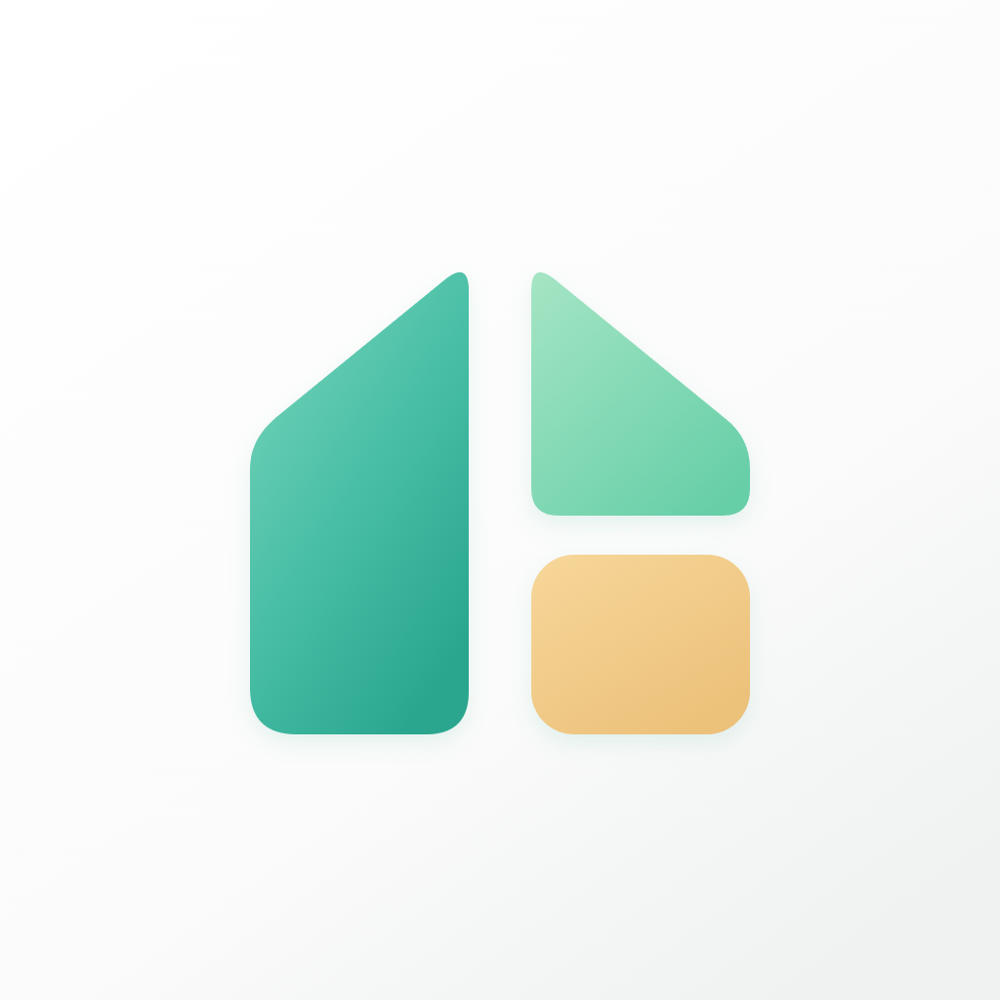
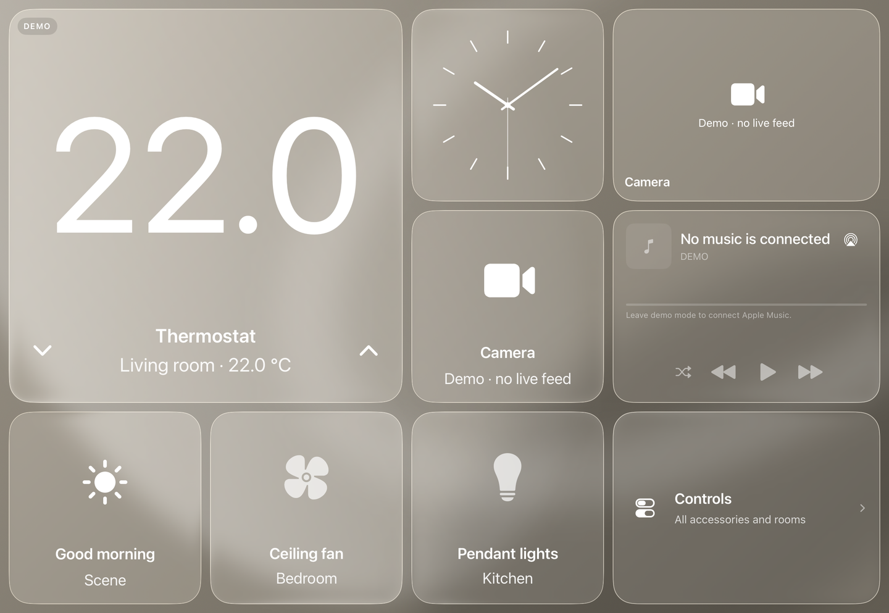
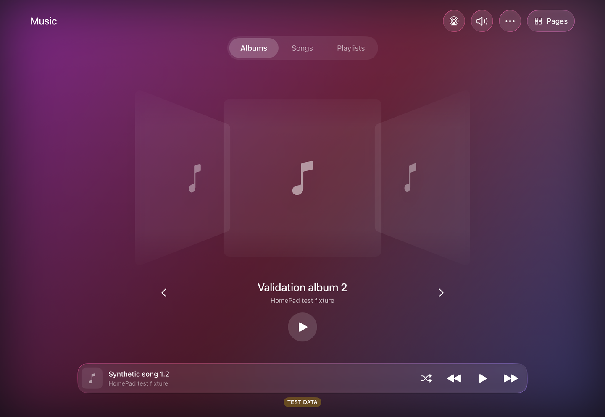
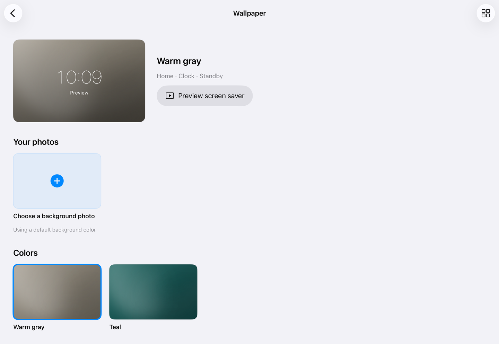

<p align="center">
  
</p>
<h1 align="center">HomePad</h1>
<p align="center"><strong>Your home, on an iPad.</strong></p>
<p align="center">Home controls · Music · Photos · Clocks · Aerial wallpapers</p>
<p align="center">
  <a href="docs/README.zh-CN.md">简体中文</a> · <a href="SETUP.md">Build and run</a> · <a href="docs/ARCHITECTURE.md">Architecture & privacy</a> · <a href="docs/VALIDATION.md">Validation</a>
</p>

HomePad turns an iPad into a shared home dashboard. Control Apple Home accessories, browse your music, display photos, and let a clock or an aerial landscape take over when the screen is idle.

HomePad is developed independently with its own interface and product direction. It is built with **SwiftUI and public Apple frameworks**, runs on **iPadOS 17+**, and uses **no third-party packages or app-owned backend**. The interface supports both landscape directions, English and Simplified Chinese, VoiceOver and larger text.

<p align="center">
  
  <br><sub>Current native interface, captured in an iPad Simulator with labeled demo accessories.</sub>
</p>

## A home dashboard that stays useful

**Home controls** — Choose your Apple Home, arrange supported accessories and shortcuts, and run scenes with confirmation. Tap an accessory icon for power or its name for supported adjustments.

**Music** — Browse Apple Music albums, songs and playlists. Flip through Cover Flow, play whole collections, manage the queue, and use the system AirPlay and volume controls. The Home music card shares playback with the full player. Local audio files are also supported.

**Photos** — Select up to 24 photos, an album or Favorites. Display a single image or a photo wall, with its own selection and rotation.

**Wallpapers** — Browse photos, colors and 12 Apple Aerials in a Mac-style thumbnail gallery. Download a video over Wi-Fi, loop it silently offline, or shuffle downloaded clips every 1, 5 or 15 minutes. Home, Clock and clock standby share your choice.

**Clocks & standby** — Keep the current page dimmed when idle, or show a clock or photo wall. Tap once to return. Configure night appearance, brightness and screen behavior in Settings.

**Weather & calendar** — Choose a weather city manually or locate it once. Connect your calendar to see the next seven days after granting permission.

<table>
  <tr>
    <td width="50%"></td>
    <td width="50%"></td>
  </tr>
  <tr>
    <td align="center">Music browsing · synthetic TEST DATA</td>
    <td align="center">One wallpaper gallery for Home, Clock and standby</td>
  </tr>
</table>

These are native screenshots, not UI mockups. Demo and test labels remain visible. Screenshot sources are recorded in [Media](docs/MEDIA.md).

## Build and try it

The current version is distributed as source. You need macOS, Xcode and a compatible iPad simulator or your own iPad.

```sh
git clone https://github.com/atom-xu/HomeViewPad.git homepad
cd homepad
open HomePad.xcodeproj
```

Select the **HomePad** scheme and an iPad simulator. Run the app and choose **Explore demo** to try the dashboard without accessories. The `--demo` launch argument opens the same deterministic demo directly.

For a physical iPad, copy `Config/Local.xcconfig.example` to `Config/Local.xcconfig` and enter your bundle identifier and development team. Use Xcode to sign and install the app. Then connect each feature from HomePad's Settings as needed:

- **Apple Home:** configure your home and accessories in Apple's Home app, then grant HomePad access.
- **Music:** enable MusicKit for your App ID and authorize the user's music account. Catalog playback requires an eligible Apple Music account.
- **Photos and calendar:** choose photos or connect your calendar through the native permission flow.
- **Wallpapers:** open **Settings → Display & standby → Wallpaper**. Aerials download when selected; shuffle uses downloaded clips only.

Full environment, simulator, signing and testing instructions: **[SETUP.md](SETUP.md)**.

## Made for a shared screen

HomePad has no app account, analytics SDK or app-owned server. System permissions control access to your home, photos, music, calendar, camera and location. Imported photos and downloaded aerials stay in the app's local storage. Weather requests use Open-Meteo; aerial downloads use Apple's servers. [Architecture & privacy](docs/ARCHITECTURE.md) explains storage, network requests and cleanup.

Standby runs while HomePad is in the foreground. It does not replace iPadOS Lock Screen or unlock a locked iPad. Optional camera-based wake needs separate consent and compatible hardware. Reduce Motion uses still aerial images and simpler transitions. See [display setup and limits](docs/IPAD-KIOSK-RESEARCH.md).

The project is actively developed. Current test results, known failures and device checks are recorded in [Validation](docs/VALIDATION.md); simulator success and an installed app are separate from real accessory or long-running display acceptance.

## Develop HomePad

- [Setup](SETUP.md) — Build, sign, run and test locally.
- [Architecture](docs/ARCHITECTURE.md) — Components, public APIs, storage and permissions.
- [Development](docs/DEVELOPMENT.md) — Project conventions and verified implementation notes.
- [Validation](docs/VALIDATION.md) — Recorded results, known issues and hardware boundaries.
- [Handoff](docs/INITIALIZATION.md) — Current branch and development history.

Development rules are in [AGENTS.md](AGENTS.md). Keep personal signing configuration and private data out of Git.

## License & acknowledgments

HomePad is released under the [MIT license](LICENSE). It originated from [HomeViewPad](https://github.com/kuscholar/HomeViewPad) by kuscholar and its contributors; their copyright and license notices are preserved. See [Credits](CREDITS.md) for source and media attribution.

Apple services, music artwork and Aerial media retain their respective owners' rights. HomePad is an independent project and is not affiliated with or endorsed by Apple.
