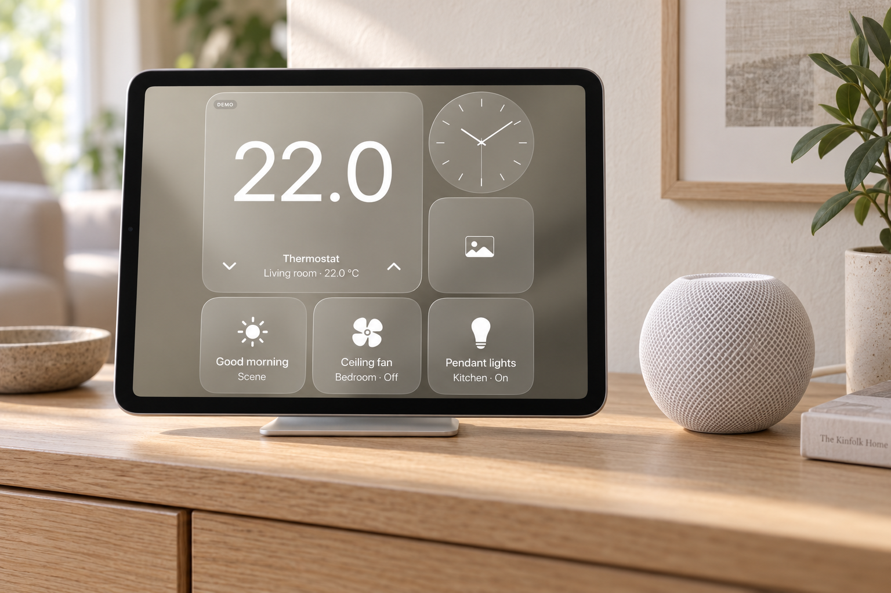

# HomeViewPad

**一眼看见家的状态。**

一个原生 SwiftUI iPad 家庭面板，把 Apple Home 控制、相册和时钟放在安静、简洁的玻璃界面中。

[English](../README.md) · [架构与隐私](ARCHITECTURE.md) · [测试记录](VALIDATION.md) · [MIT 许可证](../LICENSE)

*基于实际应用截图生成的 AI 场景示意图，屏幕显示 DEMO 数据，不代表 Apple 官方产品或真实硬件联动验证。*

## 放在家里的一块屏幕

将 iPad 放在支架或墙面上，查看温度、调整兼容温控器、控制灯光、运行已有场景；左右滑动切换时钟和照片墙。HomePod mini 可以在旁边独立承担家庭中枢和 Siri 音箱的角色；它不是使用此 App 的必需品，App 也不会与它进行直接配对。音频通过系统 AirPlay 选择器输出。

*GIF 来自运行中的 iPad 模拟器，使用确定性的虚拟配件和原创渐变测试图片，不是真实家庭设备操作。*

## 主要功能

- 全屏玻璃组件：一个大正方形温控组件与五个小组件，灰色／青绿色背景。
- 每个位置拥有独立组件栈，上下滑动切换，位置指示点仅短暂出现。
- 接入 HomeKit 家庭、房间、支持的配件和场景；写入后读取确认，温度箭头遵守设备范围与步长。
- PhotoKit 相册和单张照片选择，照片墙叠加数字时钟，前台每 30 秒轮播。
- 按需开启兼容摄像头、日历、提醒事项与本地音频播放。
- 无需设备即可体验 DEMO；演示模式不创建真实 HomeKit 管理器。

左右滑动切换主屏、时钟、照片和设置。点击背景空白处显示导航：横屏在右侧，竖屏在底部。点击照片墙也能显示导航。

## 本地运行

1. 用 Xcode 打开 `HomePad.xcodeproj`，选择 **HomePad** scheme 和 iPadOS 17 或以上的 iPad 模拟器。
2. 运行后选择 **Explore demo**。
3. 安装到自己的 iPad 时，把 `Config/Local.xcconfig.example` 复制为 `Config/Local.xcconfig`，填写自己的 Bundle ID 与开发团队。此文件已被 Git 忽略。
4. 使用真实家庭时选择 **Connect Apple Home** 并授权；照片组件中可选择单张图片，或授权访问相册。

对外名称为 HomeViewPad，工程和 scheme 暂时保留 HomePad，避免打断现有构建流程。详细构建、测试和 GIF 录制命令见[英文 README](../README.md#development)。

## 隐私与当前限制

不需要 App 账号或后端，没有分析和跟踪 SDK。家庭、照片、日历和提醒事项使用 Apple 系统权限。相册图片按需读取，iCloud 图片可能通过 PhotoKit 下载；单张导入照片会保存到 App 沙盒。App 不修改系统照片库。

这仍是早期个人项目。模拟器通过不等于真实设备验证；HomeKit 配件、摄像头、HomePod/AirPlay 与长期常亮使用仍需按[硬件清单](HARDWARE_CHECKLIST.md)验证。共享屏幕上开启的个人内容，旁人也能看见。

本 App 不是家庭中枢，不承载 Siri、不访问 HomePod 麦克风，不支持 Intercom、内嵌 FaceTime 或创建自动化。它是独立项目，与 Apple 及其他相似名称的产品没有关联。

代码采用 MIT 许可证。贡献请遵守 [AGENTS.md](../AGENTS.md)；此仓库实际 Git 提交仅允许在纽约时区工作日 22:00 之后或周末进行，不得修改或伪造时间戳。
