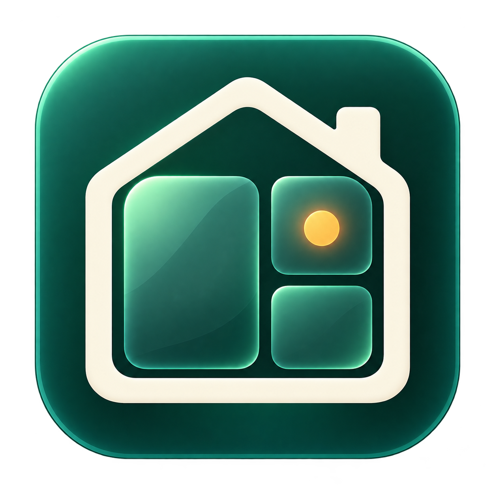
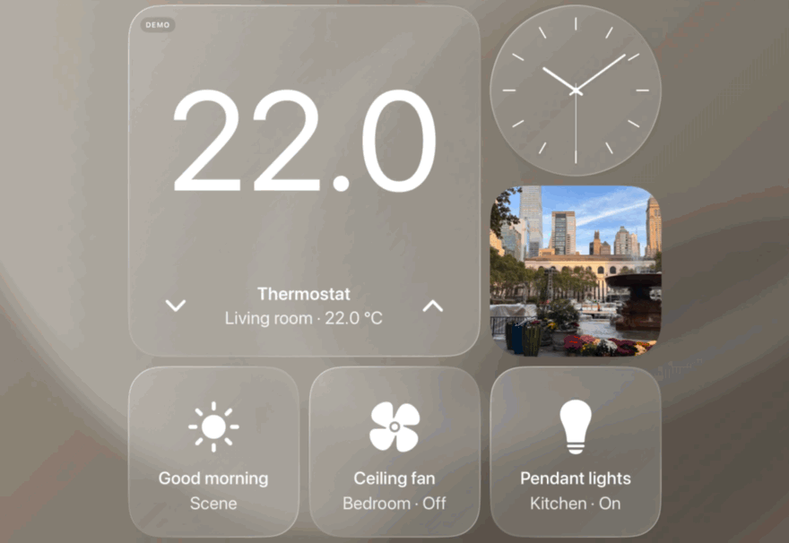

<p align="center">
  
</p>
<h1 align="center">HomePad</h1>
<p align="center">面向 iPad 的原生家庭控制、时钟、照片与前台待机面板。</p>
<p align="center"><a href="../README.md">English</a> · <a href="../SETUP.md">本地开发</a> · <a href="VALIDATION.md">验证记录</a> · <a href="ARCHITECTURE.md">架构与隐私</a></p>

HomePad 是 [kuscholar/HomeViewPad](https://github.com/kuscholar/HomeViewPad) 的个人 fork，当前仓库为 [atom-xu/HomeViewPad](https://github.com/atom-xu/HomeViewPad)，本地目录为 `homepad`。应用、Xcode 工程和 scheme 均叫 **HomePad**。项目使用 SwiftUI 与 Apple 公共框架，支持 iPadOS 17 及以上，没有第三方包或自建后端。

## 当前版本

**打开应用先进入家庭（Home）页。** 家庭操作、时钟和设置使用完整 iPad 视口；当前版本仅支持左右横屏。家庭页保留参考图的大温控、时钟与设备卡排布，左侧三列保持正方形，控件多了向下增行；右侧固定一列长方形，使用剩余宽度，逐行与左侧等高，可放监控等内容。大温控仍为 2×2 正方形；大字号保留单列滚动。照片保留为独立页面。在「设置 → 显示与待机 → 壁纸」的独立缩略图库中，按照片、颜色和 Apple 官方航拍分组选择，家庭控制、时钟与时钟待机共用此背景。航拍选中后通过 Wi-Fi 下载，离线静音循环；可按 1／5／15 分钟随机轮换已下载片段，长按卡片可移除下载。减少动态效果时显示静帧，隐藏或后台时停止播放。独立照片页保留自己的选择。详见[片源与验证说明](DYNAMIC-SCREENSAVER-10.md)。

| 功能 | 使用方式 |
| :--- | :--- |
| 家庭控制 | 选择家庭和房间，操作支持的配件，确认后运行场景。温度箭头遵守设备提供的范围和步长。 |
| 组件编辑 | 添加配件、场景、摄像头或展示组件；长按调整大小或移除。超出的组件上下滚动，演示与各个真实家庭分别保存布局。 |
| 明确状态 | 电源组件显示开启、关闭、更新中、不可用或离线；缺失读数不会被显示为关闭。 |
| 快捷功能 | 保存摄像头、场景、日历、音乐和全部控制入口；场景快捷方式仍需确认。 |
| 中英文 | 设置提供跟随系统、简体中文和 English，选择即时生效并保存。真实家庭、房间和配件名称保持原名。 |
| 独立照片页 | 手选 1–24 张、iPad 相册或个人收藏，显示最多四张的照片墙或单张全屏。四宫格保留相册组件；可见时每 30 秒轮播，照片待机墙也可轮播，打开面板或离开前台时暂停。 |
| 夜间与待机 | 手动或按时段切换夜间外观。iPad 持续接近竖直、静止且无操作达到设定时间后，进入应用内待机时钟；设置提供预览。 |

四宫格（Overview）仍是独立页面，显示日期、时钟、相册和天气。实时天气来自 [Open-Meteo](https://open-meteo.com/)，支持前台定位或手动选城市。独立音乐页可连接 Apple Music、浏览资料库及搜索曲库，也保留文件播放。日程需主动连接，仅读取未来七天事件，不请求提醒事项；音频使用系统 AirPlay 选择器。HomePod mini 通过 Apple「家庭」和 AirPlay 独立工作。

演示模式显示 **DEMO / 演示** 标记，家庭数据、时间与天气使用固定示例，不创建真实 HomeKit 管理器。演示摄像头只是占位界面，不是实时画面。

## 常用操作

| 操作 | 效果 |
| :--- | :--- |
| 长按组件选择「显示导航」 | 在右侧打开导航。 |
| 左右滑动 | 按四宫格 → 家庭 → 时钟 → 照片 → 设置切换页面。 |
| 在家庭控制区上下滚动 | 查看更多组件。 |
| 长按组件选择切换分类 | 切换该分类的内容，不操作设备。 |
| 长按组件 | 调整大小或移除。 |
| 点击待机屏幕 | 回到此前页面。 |

动画支持系统「减弱动态效果」，各分类内容独立。家庭页已移除照片卡片；通过导航中的「照片」或「相册」配置图片。首页不显示家庭名、房间筛选或编辑工具栏；房间筛选位于全部控制面板。

## 开始使用

需要 macOS、Xcode 与匹配的 iPad 模拟器 runtime。环境检查、独立模拟器和测试命令见 [SETUP.md](../SETUP.md)。

```sh
git clone https://github.com/atom-xu/HomeViewPad.git homepad
cd homepad
open HomePad.xcodeproj
```

选择 **HomePad** scheme 和可用的 iPad 模拟器运行，在家庭页点击「体验演示」（Explore demo）。演示不需要家庭配件；也可加入 `--demo` 启动参数直接进入固定演示。

安装到自己的 iPad：

1. 将 `Config/Local.xcconfig.example` 复制为已忽略的 `Config/Local.xcconfig`，填入唯一 Bundle ID 和开发团队。
2. 连接并配对 iPad，完成 Apple 签名、设备信任和开发者模式要求，用 HomePad scheme 运行。
3. 在家庭页选择「连接 Apple 家庭」并授权；家庭、配件和场景先在 Apple「家庭」App 中配置。
4. 在独立照片页选择图片或授权相册。有限照片权限只显示允许访问的图片。

编译、模拟器运行、真机安装和真实配件验收是不同结果。请查看[当前验证记录](VALIDATION.md)和[硬件验收清单](HARDWARE_CHECKLIST.md)。

## 前台展示与隐私边界

待机是**应用保持在前台时的展示模式**。触摸恢复操作界面，支持的运动传感器也可恢复。前置相机人脸唤醒默认关闭；开启并授予系统相机权限后，仅在待机时检测。另有独立的「允许持续前台人脸检测」开关，明确同意后才在非待机页面继续采样，包括唤醒之后。这项新选择默认关闭，旧人脸唤醒设置及系统相机权限不会自动扩大检测范围。开启新选项后，持续有人在场时延后自动待机，离开满设定空闲时限后才再次待机；系统自动锁定遵循所选「屏幕行为」。关闭新选项恢复为仅待机检测；关闭人脸唤醒总开关也会清除这项额外同意。只检测有没有人脸，不识别身份，不保存图片、不录制视频、不上传画面。打开导航、面板或场景确认时暂停，离开前台后停止；检测运行期间持续显示系统相机指示。

接近唤醒取决于设备是否向应用开放支持的接近传感器，不能把通用红外当作所有 iPad 都有的功能。应用不能解锁或唤醒系统已锁定的 iPad，不能替代系统锁屏，也不能保证重启后自动打开。用于专用展示时，可由用户在 iPad 设置中开启「引导式访问」。能力与方案见[常驻展示研究](IPAD-KIOSK-RESEARCH.md)。

夜间模式让应用使用较暗外观，待机时还会临时降低屏幕亮度、使用柔和暖色时钟；退出待机或离开前台后恢复亮度。感知距离、姿态效果、发热、耗电与长期常驻仍需实体 iPad 验证。

无需 App 账号、分析 SDK 或跟踪服务。HomeKit、PhotoKit、MusicKit、EventKit 和 AirPlay 继续使用系统授权。应用不修改系统照片库；手选照片的副本保存在应用沙盒，单张壁纸独立保存。共享屏幕上的内容，附近的人可以看见。

天气会将城市搜索和坐标发给 Open-Meteo；自动坐标取整到约 1 公里精度并保留在内存，手动城市与单位保存在本机。免费接口有个人／非商业使用条款，商业发行前应检查提供方的[许可方案](https://open-meteo.com/en/pricing)。详见[数据生命周期](ARCHITECTURE.md)。

HomePad 不是家庭中枢，不承载 Siri、不访问 HomePod 麦克风，也不提供 Intercom、内嵌 FaceTime、家庭成员身份识别或后台摄像头录制。Apple Music 需要开发者后台启用 MusicKit、用户授权及可播放该曲目的账号／订阅。已有场景可能影响门锁等设备，执行前始终要求确认。

## 上游历史素材

<p align="center">
  
  <br><sub>保留的上游录屏，展示旧版正方形布局和手势；不是当前 fork 界面或本轮验收证据。</sub>
</p>

保留的[场景示意图](media/ipad-homepod-use-case.png)同样使用旧截图。素材来源见[原始媒体说明](MEDIA.md)，不能据此认定新布局、待机感知或硬件联动已验收。当前结果以 [VALIDATION.md](VALIDATION.md) 为准。

## 开发与贡献

开发前阅读 [SETUP.md](../SETUP.md)、[开发约定](DEVELOPMENT.md)、[初始化与交接](INITIALIZATION.md)和 [AGENTS.md](../AGENTS.md)。本轮范围见 [IPAD-DISPLAY-01](IPAD-DISPLAY-01.md)。

日常测试使用独立模拟器与合成照片。行为变化后运行 HomePad scheme 的 XCTest/XCUITest，布局变化后导出并检查截图，分别报告运行环境、失败和硬件未测项。新增源码后运行 `python3 scripts/generate_project.py`，保留有意的工程设置，个人签名配置不进入 Git。

只使用公共 API、原创或已获许可的素材。实际 Git 提交限 America/New_York 工作日 22:00 后或周末，先运行 `python3 scripts/commit_guard.py`，不倒签时间；推送和发布需另有明确授权及目的地。

[MIT 许可证](../LICENSE) · [上游仓库](https://github.com/kuscholar/HomeViewPad) · [架构](ARCHITECTURE.md) · [验证记录](VALIDATION.md)

Apple、iPad、HomePod mini、HomeKit 和 AirPlay 属于 Apple Inc.。HomePad 是独立项目，与 Apple 没有关联或背书。用于标识真实来源的上游名称和历史素材文件名保留原样。
